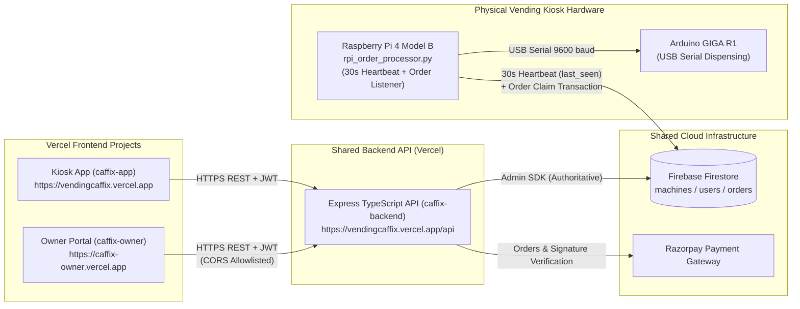

# CAFFIX Owner Dashboard — Production Release & Deployment Checklist

This document provides the complete step-by-step deployment, configuration, verification, and rollback procedures for the **CAFFIX Multi-Machine Owner Dashboard (`caffix-owner`)**, **Shared Backend API (`caffix-backend`)**, and **Raspberry Pi 4 Heartbeat Integration**.

---

## A. Current Architecture



1. **Existing Kiosk Vercel Project (`caffix-app`)**:
   - Served at `https://vendingcaffix.vercel.app`.
   - Remains 100% unmodified in this release.
2. **Existing Shared Backend API (`caffix-backend`)**:
   - Served at `https://vendingcaffix.vercel.app/api`.
   - Provides JWT authentication, atomic single-use SHA-256 owner invitation setup, live database/Firestore machine ownership enforcement, per-machine product pricing & availability, safe maintenance mode transitions, and Razorpay order/payment verification.
3. **New Owner Dashboard Vercel Project (`caffix-owner`)**:
   - Standalone React + Vite + Tailwind CSS v4 portal inside `caffix-owner/`.
   - Deployed as a separate Vercel project at `https://caffix-owner.vercel.app`.
   - Communicates exclusively with `https://vendingcaffix.vercel.app/api` via `VITE_API_BASE_URL` and never holds Firebase Admin or Razorpay secret keys.
4. **Shared Firebase/Firestore Backend**:
   - Authoritative persistence across Vercel serverless cold starts for `users/{id}`, `machines/{id}` (including `desired_mode`, `last_seen`, `owner_id`, `products`, `estimated_inventory`), and `orders/{id}`.
5. **Raspberry Pi 4 Heartbeat Integration**:
   - [`rpi_order_processor.py`](./rpi_order_processor.py) runs as a background daemon via [`caffix-vending.service`](./caffix-vending.service) and writes `last_seen` to `machines/{machine_id}` every 30 seconds (`merge=True`) without overwriting `desired_mode`, `status`, `owner_id`, `products`, or `estimated_inventory`.
   - The backend computes `connection_status: "ONLINE"` when `last_seen` is within the last 90 seconds, and `"OFFLINE"` otherwise.

---

## B. Backend Deployment (`caffix-backend`)

### 1. Existing Vercel Project Settings
- **Project**: Existing `vendingcaffix` Vercel deployment.
- **API Route Entry**: `/api/*` routed to `caffix-backend`.
- **Build Command**: `npm run build` (compiles TypeScript into `caffix-backend/dist`).

### 2. Required Environment Variables
Verify the following environment variables are configured in the existing backend Vercel project:

| Variable Name | Required | Description |
| :--- | :---: | :--- |
| `JWT_SECRET` | Yes | Strong secret used to sign and verify 24h Admin, Owner, and Kiosk JWTs |
| `KIOSK_SECRET` | Yes | Shared or default kiosk verification token |
| `KIOSK_MACHINE_KEYS` | Optional | Per-machine kiosk keys (`CFX-MC-01:key1,CFX-MC-02:key2,...`) |
| `REGISTERED_MACHINES` | Optional | Comma-separated machine IDs (`CFX-MC-01,CFX-MC-02,CFX-MC-03`) |
| `ADMIN_PASSCODE` | Yes | Local kiosk PIN unlock passcode |
| `RAZORPAY_KEY_ID` | Yes | Razorpay API Key ID |
| `RAZORPAY_KEY_SECRET` | Yes | Razorpay API Key Secret (Backend only) |
| `RAZORPAY_WEBHOOK_SECRET` | Yes | Razorpay Webhook Signature Secret |
| `FIREBASE_PROJECT_ID` | Yes | Firebase project ID |
| `FIREBASE_CLIENT_EMAIL` | Yes | Firebase Admin SDK service account client email |
| `FIREBASE_PRIVATE_KEY` | Yes | Firebase Admin SDK private key (with `\n` newlines preserved) |
| `CORS_ALLOWED_ORIGINS` | Optional | Additional comma-separated allowed browser origins |

### 3. CORS Configuration
[`caffix-backend/src/index.ts`](./caffix-backend/src/index.ts) enforces an explicit origin allowlist (`isAllowedCorsOrigin`) and never uses wildcard `*` for browser origins:
- `https://caffix-owner.vercel.app` (Production Owner Portal)
- `https://vendingcaffix.vercel.app` (Production Kiosk App)
- `http://localhost:*` and `http://127.0.0.1:*` (Local development & Raspberry Pi Chromium kiosk)
- Additional origins specified in `CORS_ALLOWED_ORIGINS`

### 4. Firebase Service Account Configuration
- Ensure `FIREBASE_PROJECT_ID`, `FIREBASE_CLIENT_EMAIL`, and `FIREBASE_PRIVATE_KEY` point to the existing production Firebase project used by the kiosks and Raspberry Pi units.
- No second Firebase project is required.

### 5. Build and Verification Steps
```bash
cd caffix-backend
npm install
npm run build
node dist/tests/stage2_auth_ownership.test.js
node dist/tests/stage3_pricing_maintenance.test.js
```
After deployment, verify health and CORS headers:
```bash
curl -i -H "Origin: https://caffix-owner.vercel.app" https://vendingcaffix.vercel.app/api/health
```
Confirm HTTP `200 OK` and header `Access-Control-Allow-Origin: https://caffix-owner.vercel.app`.

### 6. Backend Rollback Procedure
- **Git Rollback**: Reset or redeploy from tag `checkpoint-pre-stage1` (branch `backup-pre-owner-dashboard`, commit `3393a48`).
- **Vercel Instant Rollback**: In the Vercel Dashboard for `vendingcaffix`, open **Deployments**, select the previous production deployment, and click **Instant Rollback**.

---

## C. Owner Dashboard Deployment (`caffix-owner`)

### 1. Vercel Project Settings
Create a new Vercel project connected to the same Git repository with the following exact settings:

| Setting | Value |
| :--- | :--- |
| **Project Name** | `caffix-owner` |
| **Framework Preset** | `Vite` |
| **Root Directory** | `caffix-owner` |
| **Build Command** | `npm run build` |
| **Output Directory** | `dist` |
| **Install Command** | `npm install` |
| **Custom Domain** | `caffix-owner.vercel.app` |

### 2. Environment Variables (`caffix-owner` Vercel Project)

| Variable Name | Value | Environment Scope |
| :--- | :--- | :--- |
| `VITE_API_BASE_URL` | `https://vendingcaffix.vercel.app/api` | Production, Preview, Development |

> **Security Requirement**: Do **NOT** add `FIREBASE_PRIVATE_KEY`, `RAZORPAY_KEY_SECRET`, or `JWT_SECRET` to the `caffix-owner` Vercel project.

### 3. Deployment Verification Steps
1. Open `https://caffix-owner.vercel.app`.
2. Confirm the CAFFIX Owner Sign-In screen loads over HTTPS with zero console or CORS errors.
3. Sign in with the Admin account and verify `/api/auth/me`, `/api/machines`, and `/api/orders` return `200 OK`.
4. Generate a test Owner invitation in **Fleet & Owners (Admin)** and verify the copied setup URL uses the `#setup_token=...&email=...` URL fragment.

---

## D. Raspberry Pi 4 Deployment

### 1. Machine ID Configuration (`/etc/caffix/machine.env`)
On each Raspberry Pi 4 unit, create `/etc/caffix/machine.env` with root-only read permissions (`chmod 600`):
```ini
# /etc/caffix/machine.env (Configure CFX-MC-01, CFX-MC-02, or CFX-MC-03 per unit)
MACHINE_ID=CFX-MC-01
HEARTBEAT_INTERVAL_SECONDS=30
GOOGLE_APPLICATION_CREDENTIALS=/home/pi/caffix/serviceAccountKey.json
```

### 2. Python Dependencies
Verify the virtual environment or system Python packages are installed:
```bash
cd /home/pi/caffix
python3 -m pip install firebase-admin pyserial
python3 test_rpi_heartbeat.py
```

### 3. Systemd Service Installation (`caffix-vending.service`)
```bash
sudo cp /home/pi/caffix/caffix-vending.service /etc/systemd/system/caffix-vending.service
sudo chmod 644 /etc/systemd/system/caffix-vending.service
sudo systemctl daemon-reload
sudo systemctl enable caffix-vending.service
```

### 4. Service Restart and Log Verification
```bash
sudo systemctl restart caffix-vending.service
sudo systemctl status caffix-vending.service
sudo journalctl -u caffix-vending.service -f -n 50
```
Confirm log output shows:
- `Heartbeat thread started for machine CFX-MC-01 (interval: 30s)`
- `Heartbeat sent for machine CFX-MC-01 at <ISO-8601 timestamp>`

### 5. Heartbeat Verification in Firestore
- Open Firestore collection `machines/{machine_id}` (e.g., `machines/CFX-MC-01`).
- Confirm `last_seen` updates every 30 seconds.
- Confirm `desired_mode`, `status`, `owner_id`, `products`, and `estimated_inventory` remain untouched by heartbeat updates.

### 6. Raspberry Pi Rollback Instructions
```bash
cd /home/pi/caffix
git checkout checkpoint-pre-stage1 -- rpi_order_processor.py caffix-vending.service
sudo cp /home/pi/caffix/caffix-vending.service /etc/systemd/system/caffix-vending.service
sudo systemctl daemon-reload
sudo systemctl restart caffix-vending.service
```

---

## E. Production Acceptance Tests

Execute and check off all 12 acceptance tests after deployment:

- [ ] **1. Existing customer kiosk loads correctly**: Open `https://vendingcaffix.vercel.app/?kiosk=<KIOSK_SECRET>&machine_id=CFX-MC-01` and verify all beverages, images, and prices render cleanly.
- [ ] **2. Customer can complete a test payment**: Select a beverage on `CFX-MC-01` and complete a test Razorpay checkout.
- [ ] **3. Razorpay payment verification works**: Confirm `/api/payments/verify` validates the signature, transitions the order from `PENDING` to `PAID`, deducts software-estimated inventory, and syncs the order to Firestore.
- [ ] **4. Raspberry Pi heartbeat reports `ONLINE`**: With `caffix-vending.service` running on the Raspberry Pi 4, verify the machine card in `caffix-owner` shows `ONLINE` and a live relative heartbeat (`< 30s ago`).
- [ ] **5. Offline detection works after 90 seconds**: Stop `caffix-vending.service` (`sudo systemctl stop caffix-vending.service`), wait >90 seconds, refresh `caffix-owner`, and verify `connection_status` changes to `OFFLINE` while `desired_mode` remains unchanged. Restart the service afterward.
- [ ] **6. Owner login works**: Invite a customer owner, open the `#setup_token=...` link, set a password, verify the URL fragment is immediately cleared from the browser bar, and sign in.
- [ ] **7. Owner sees only assigned machines**: Log in as Owner A (assigned `CFX-MC-01`) and confirm only `CFX-MC-01` appears in Overview, My Machines, Machine Details, Products & Pricing, Orders, and Sales Reports.
- [ ] **8. Admin can manage all machines**: Log in as Admin and confirm all machines (`CFX-MC-01`, `CFX-MC-02`, `CFX-MC-03`) are visible and manageable, including live owner assignment/unassignment.
- [ ] **9. Per-machine pricing works**: Update Classic Crest to `₹110` on `CFX-MC-01` and `₹135` on `CFX-MC-02`; verify each kiosk displays and charges its own machine-specific price.
- [ ] **10. Maintenance mode works without interrupting paid orders**: Switch `CFX-MC-01` to `MAINTENANCE` mode; verify new order creation is blocked (`400 Bad Request`) while an already-created/paid order is still permitted to complete payment verification and dispensing.
- [ ] **11. Historical sales reports are accurate**: Complete an order at `₹110`, then change the beverage price to `₹150`; verify Order History and Sales Reports still report `₹110` for the historical transaction.
- [ ] **12. One owner cannot access another owner's machines or orders**: Using Owner A's JWT, attempt direct API calls to Owner B's machine (`GET /api/machines/CFX-MC-03`, `PATCH /api/machines/CFX-MC-03/status`, `PUT /api/machines/CFX-MC-03/products/1`, `GET /api/orders?machine_id=CFX-MC-03`) and confirm every request is rejected with `403 Forbidden`.

